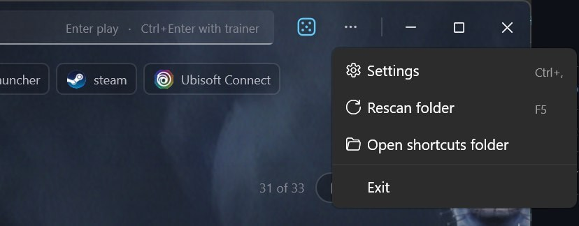
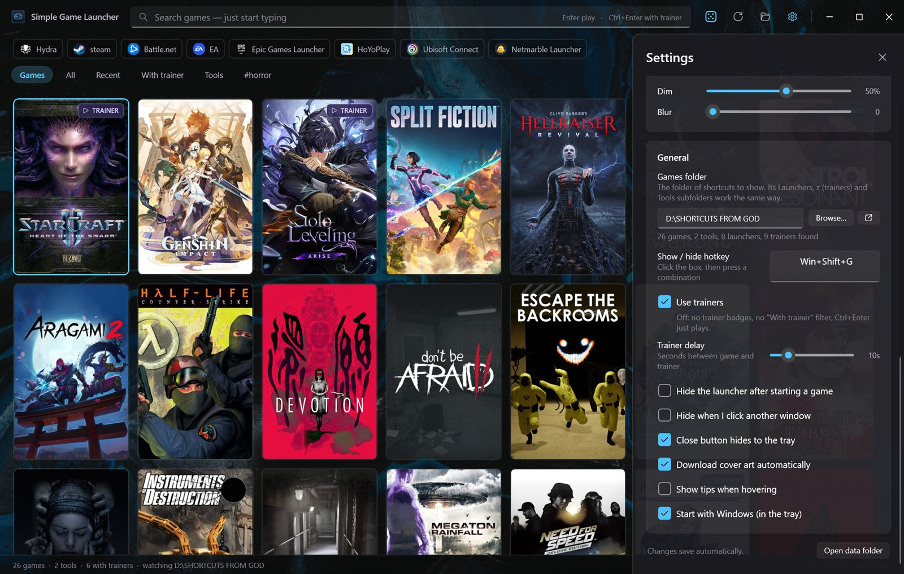

# Simple Game Launcher

[](https://github.com/iosifv/simple-game-launcher/releases/latest)


**Your game shortcuts, as a launcher that looks like it belongs on a gaming PC.** Point it at a folder of `.lnk` / `.url` shortcuts and it becomes a fast, searchable wall of cover art. The window takes on the look of whatever game you're pointing at. No account, no store, no library import, no background services: one small exe.


## Why it rocks

- 🎨 **Every game sets the mood.** Point at a game and the whole window fades to its Steam artwork, its name appears above the filters, and every highlight takes the colour of its cover.
- ⚡ **Start typing, press Enter, you're playing.** Search by name, initials (`bmw` → Black Myth Wukong), tag or folder. A global hotkey brings it up from anywhere.
- 🖼️ **Cover art finds itself.** Steam, the Microsoft Store and GOG are searched for you, in landscape or portrait. Or pick your own art for each game.
- 🃏 **Cards that feel alive.** They lift, glow in their own colours and show a ▶ play button. The rest of the grid dims into a spotlight.
- 🎲 **Can't decide?** Roll the dice and let it pick.
- 🧰 **Trainers built in.** Ctrl+Enter starts a game together with its trainer.
- 🪶 **Light and native.** WPF on .NET 10, Windows 11 Mica, dark everywhere (even the tray menu). It never changes your shortcut files.

## Download

1. Get **GameLauncher.exe** from the [latest release](https://github.com/iosifv/simple-game-launcher/releases/latest).
2. Put it in a folder of its own, for example `Documents\Game Launcher`. It keeps its settings and cover art next to itself, so avoid `Program Files`.
3. Double-click it. On first start it asks for your games folder: the folder with your game shortcuts.

It's a single file with everything included: no installer, nothing else to install. Windows may show a SmartScreen warning because the exe isn't signed: click **More info → Run anyway**.

To update, replace `GameLauncher.exe` with the new one. Your settings, covers and wallpapers next to it are kept.

## What's new

- **A new look.** The game you point at (or select) fills the window with its artwork and puts its name above the filters. The accent colour follows its cover. Very bright artwork is toned down automatically so text stays readable.
- **Spotlight:** the other cards dim while you point at one. You choose how much (10–90%).
- **Compact title bar:** just search, the dice and a **⋯** menu for settings, rescan, open folder and exit.
- **Smoother play button:** its colour fades in and out.
- Every part of the new look has its own switch in **Settings → Look**. Turn them all off for the classic look.

Earlier in 1.0.4: hide games, Delete to the Recycle Bin, window position remembered per monitor, tag icons.

## A tour

### Every game sets the mood

Pointing at a game (or selecting it with the keyboard) fades the background to its wide Steam artwork. Games that aren't on Steam get a soft blur of their cover instead. The highlight colour glides to match the cover. Portrait cards use Steam's tall library art:


### Cards that feel alive

- The card **lifts with a little spring**, a light **sweeps** across it and it **glows in its own colours**.
- A **▶ play button** pops in: click to play, Ctrl+click to play with the trainer.
- **Spotlight** dims the rest of the grid so the game you're pointing at stands out.
- Cards without any cover get a soft glow in the colours of the game's icon.

### A title bar that stays out of the way

Search, the random-game dice and one **⋯** menu. Everything else is a click away (and Ctrl+, / F5 still work):



### Make it yours

- **Arrange mode:** drag games, filter tabs and launchers into your own order. Alt+arrows nudge, Reset puts everything back A–Z.
- **Tags** with a one-click editor. Each tag becomes its own filter, shown with a tag icon.
- **Hide** games you don't want to see. They only show up under the **Hidden** filter, and **Show again** brings them back. **Delete…** moves a shortcut to the Recycle Bin, after asking.
- **Landscape or portrait cards**, card size, spacing and names under the cards, all adjustable.
- **Wallpapers** per filter, with dim and blur.
- The window reopens **where you left it**: same monitor, same size, or maximized, even with several monitors.


| Look: art, accent, spotlight, title bar | Cards, spacing, scrolling and the dice | General: trainers, tips and more |
| --- | --- | --- |
|  |  |  |

### Find and start games fast

- **Just start typing** to search. Enter plays, Ctrl+Enter plays with the trainer.
- **The dice** picks a random game from the filter you're on (and can start it for you). Pick its colour in Settings.
- **Launcher bar** with your store apps (Steam, Epic, EA, Battle.net, …) from a `Launchers` subfolder.
- **Filters:** Games, All, Recent, With trainer, one per subfolder (e.g. `Tools`), one per tag, and Hidden.
- **Global hotkey** (default `Win+Shift+G`) and a dark tray menu.
- **Live folder watching:** add, remove or rename a shortcut and the grid updates within a second.
- The mouse wheel can **scroll one row at a time**.

### Trainers

- Put trainers in a `z` subfolder: `.exe` files with "trainer" in the name, or any shortcut (`.lnk` / `.url`). They're matched to games by name and get a TRAINER badge.
- **Ctrl+Enter** (or Ctrl+click on ▶) starts the game, then the trainer after a delay you choose.
- Don't use trainers? Switch them off in Settings: the badges, the "With trainer" filter and the trainer menus disappear.

## Folder layout it understands

```
My Games Folder\
├─ Some Game.lnk           ← games (any .lnk / .url)
├─ Another Game.url
├─ Launchers\              ← shown as the launcher bar
├─ z\                      ← trainers (*Trainer*.exe, or any .lnk / .url), matched to games by name
└─ Tools\                  ← any other subfolder becomes its own filter tab
                             (Tools is excluded from the Games filter)
```

Shortcuts themselves are never modified: the launcher only reads them. The one exception is **Delete…**, which asks first and moves the file to the Recycle Bin.

## Where the artwork comes from

| Source | Used for |
| --- | --- |
| Your own image | Always wins. Set per shape (landscape / portrait) from the tile's **Cover** menu, or search with **Find cover online…**. |
| Steam | Steam games: the app id from a `steam://` link, otherwise an exact name match. Covers, tall library art and the wide background art. |
| Microsoft Store, GOG | Games Steam doesn't have, by exact name. Also searchable in **Find cover online…**. |

Epic doesn't allow outside apps to search its store, but many Epic games are also on the Microsoft Store and are found there. Everything downloaded is cached in `covers\` next to the exe.

## Keyboard

| Keys | Action |
| --- | --- |
| type anything | search (name, initials like `bmw`, tags, folder) |
| Arrows · Enter | select · play |
| Ctrl+Enter | play with trainer (when trainers are on) |
| Esc | clear search / hide |
| Ctrl+Tab | next filter |
| Ctrl + / − / 0, Ctrl+wheel | card size |
| Ctrl+, | settings |
| F5 | rescan |

## Data

Everything the launcher remembers lives next to the exe: `launcher-data.json` (settings, tags, trainer choices, play history, custom order, hidden games), `covers\` and `wallpapers\`. To move it to another PC, copy the folder.

## Requirements

- Windows 11 (Windows 10 works without the Mica background), 64-bit
- To build from source: .NET 10 SDK. The release exe needs nothing extra; a build with `--self-contained false` needs the [.NET 10 Desktop Runtime](https://dotnet.microsoft.com/download/dotnet/10.0).

## Build and run

```powershell
dotnet run                                   # debug run
dotnet publish -c Release -r win-x64 --self-contained false `
  -p:PublishSingleFile=true -p:IncludeNativeLibrariesForSelfExtract=true -p:DebugType=none -o app
```

The published `app\GameLauncher.exe` is a single file. On first start it opens Settings so you can pick your games folder.

## Releasing

Push a version tag and GitHub Actions builds the self-contained exe and publishes the release:

```powershell
git tag v1.0.6
git push origin v1.0.6
```
