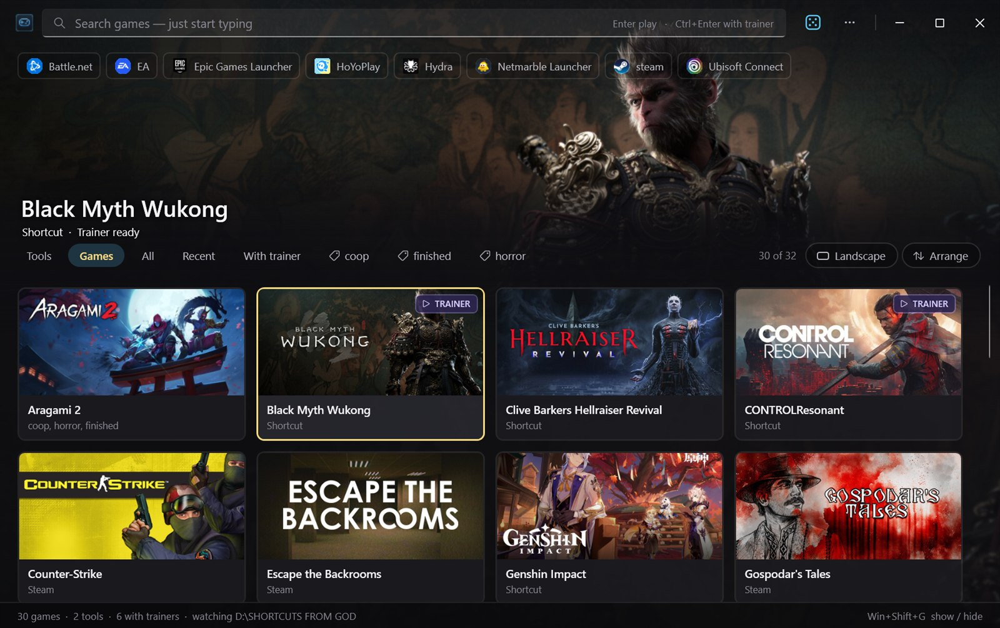

# Simple Game Launcher

A small, native Windows 11 launcher for a folder of game shortcuts. Point it at a folder full of `.lnk` / `.url` shortcuts and it turns them into a searchable grid of cover-art tiles: no browser, no account, no library import.



## Download

1. Get **GameLauncher.exe** from the [latest release](https://github.com/iosifv/simple-game-launcher/releases/latest).
2. Put it in a folder of its own, for example `Documents\Game Launcher`. It keeps its settings and cover art next to itself, so avoid `Program Files`.
3. Double-click it. On first start it asks for your games folder: the folder with your game shortcuts.

It's a single file with everything included: no installer, nothing else to install. Windows may show a SmartScreen warning because the exe isn't signed: click **More info → Run anyway**.

To update, replace `GameLauncher.exe` with the new one. Your settings, covers and wallpapers next to it are kept.

## What's new

- **New look:** point at or select a game and the window fills with its Steam artwork, its name shows above the filters, the highlight colour follows its cover, and the other cards dim a little (spotlight). The title bar is tidier, with settings, rescan and open folder under a ⋯ menu. Each of them can be switched off in Settings → Look.
- **Hide games** you don't want to see (right-click → Hide). They move to a **Hidden** filter, where Show again brings them back. The shortcut file stays where it is.
- **Delete…** (right-click a game or launcher) moves the shortcut to the Recycle Bin after asking.
- **Remembers where the window was**: same monitor, same size, or maximized, also with several monitors.
- Tag filters show a **tag icon**.
- **Play button on hover:** point at a game and a ▶ button appears. Click to play, Ctrl+click to play with the trainer.
- **Random game dice** in the title bar: it rolls across your games and lands on one. Pick its colour in Settings.
- **Card spacing** slider and **scroll one row at a time** (smooth mouse-wheel scrolling).
- **Turn trainers off** completely, and **turn hover tips off**, from Settings.
- **Any shortcut in the `z` folder** now works as a trainer, not just `.exe` files.
- **Dark tray menu**, and launchers can be reordered in Arrange mode.

## Features

**Your games, at a glance**
- **Cover art found for you.** Steam art for Steam games; for everything else the Microsoft Store (Xbox) and GOG are searched by name. Covers are cached locally.
- **Find cover online…** (right-click a game → Cover): search Steam, the Microsoft Store and GOG yourself, preview the results and pick a landscape and a portrait image separately. Or use any image file.
- **Landscape or portrait cards**, switched with one click, with or without names under them.
- **Tiles without a cover** get a soft glow in the colours of the game's icon.
- **Hover effect:** the card lifts, a light sweeps across it, it glows in the cover's own colours and a ▶ play button pops up.
- **Game art in the background:** the game you point at or select fills the window with its wide Steam artwork (or a soft blur of its cover), and the accent colour follows it.
- **Spacing** between cards is adjustable, and the mouse wheel can **scroll one row at a time**.


**Find and start games fast**
- **Just start typing** to search by name, initials (`bmw` → Black Myth Wukong), tag or folder. Enter plays.
- **Can't decide?** The dice in the title bar picks a random game from the filter you're on (and can start it for you).
- **Launcher bar** with your store apps (Steam, Epic, EA, Battle.net, …) from a `Launchers` subfolder.
- **Filters:** Games, All, Recent, With trainer, one tab per subfolder (e.g. `Tools`), one per tag, and Hidden.
- **Global hotkey** (default `Win+Shift+G`) and a dark tray icon menu: the launcher is always one keypress away.
- **Live folder watching:** add, remove or rename a shortcut and the grid updates within a second.

**Make it yours**
- **Arrange mode:** drag games, filter tabs and launchers into your own order. Alt+arrows nudge, Reset puts everything back A–Z.
- **Tags** with a one-click tag editor.
- **Hide** games without deleting anything: they only show up under the Hidden filter. **Delete…** sends a shortcut to the Recycle Bin (after asking).
- The window opens where you left it, on the same monitor, at the same size or maximized.
- **Wallpapers** per filter, with dim and blur. Adjustable card size, Mica window, start with Windows.
- **Hover tips** (game names, play and trainer hints, button descriptions) can be switched off.


**Trainers**
- Put trainers in a `z` subfolder: `.exe` files with "trainer" in the name, or any shortcut (`.lnk` / `.url`), for example to a companion tool. They're matched to games by name and get a TRAINER badge.
- **Ctrl+Enter** (or Ctrl+click on ▶) starts the game, then the trainer after a delay you choose.
- Don't use trainers? Switch them off in Settings: the badges, the "With trainer" filter and the trainer menus disappear.

| Cards, spacing, scrolling and the dice | General: trainers, tips and more |
| --- | --- |
|  |  |

## Folder layout it understands

```
My Games Folder\
├─ Some Game.lnk           ← games (any .lnk / .url)
├─ Another Game.url
├─ Launchers\              ← shown as the launcher bar
├─ z\                      ← trainers (*Trainer*.exe, or any .lnk / .url), matched to games by name
└─ Tools\                  ← any other subfolder becomes its own filter tab
                             (Tools is excluded from the Games filter)
```

Shortcuts themselves are never modified: the launcher only reads them.

## Where cover art comes from

| Source | Used for |
| --- | --- |
| Your own image | Always wins. Set per shape (landscape / portrait) from the tile's **Cover** menu. |
| Steam | Steam games: the app id from a `steam://` link, otherwise an exact name match. |
| Microsoft Store, GOG | Games Steam doesn't have, by exact name. Also searchable in **Find cover online…**. |

Epic doesn't allow outside apps to search its store, but many Epic games are also on the Microsoft Store and are found there.

## Keyboard

| Keys | Action |
| --- | --- |
| type anything | search (name, initials like `bmw`, tags, folder) |
| Arrows · Enter | select · play |
| Ctrl+Enter | play with trainer (when trainers are on) |
| Esc | clear search / hide |
| Ctrl+Tab | next filter |
| Ctrl + / − / 0, Ctrl+wheel | card size |
| Ctrl+, | settings |
| F5 | rescan |

## Data

Everything the launcher remembers lives next to the exe: `launcher-data.json` (settings, tags, trainer choices, play history, custom order), `covers\` and `wallpapers\`. To move it to another PC, copy the folder.

## Requirements

- Windows 11 (Windows 10 works without the Mica background), 64-bit
- To build from source: .NET 10 SDK. The release exe needs nothing extra; a build with `--self-contained false` needs the [.NET 10 Desktop Runtime](https://dotnet.microsoft.com/download/dotnet/10.0).

## Build and run

```powershell
dotnet run                                   # debug run
dotnet publish -c Release -r win-x64 --self-contained false `
  -p:PublishSingleFile=true -p:IncludeNativeLibrariesForSelfExtract=true -p:DebugType=none -o app
```

The published `app\GameLauncher.exe` is a single file. On first start it opens Settings so you can pick your games folder.

## Releasing

Push a version tag and GitHub Actions builds the self-contained exe and publishes the release:

```powershell
git tag v1.0.4
git push origin v1.0.4
```
