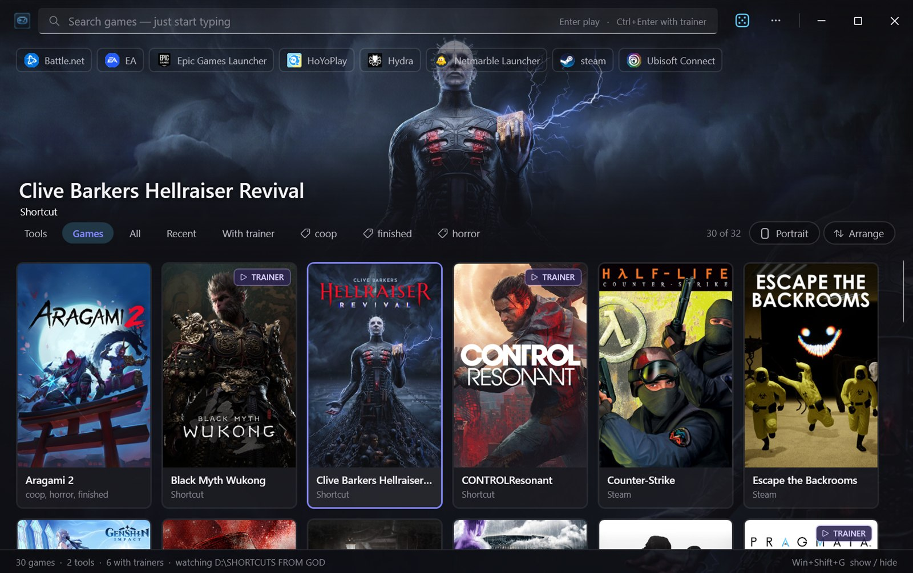
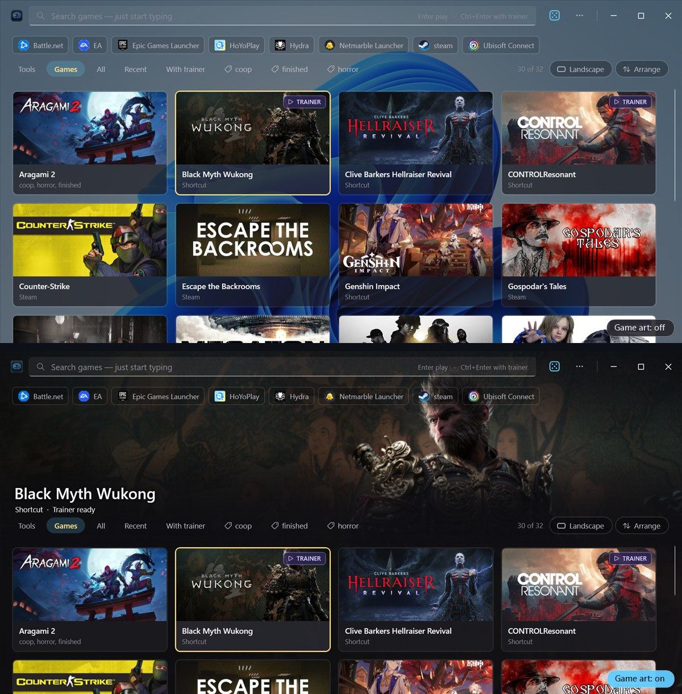
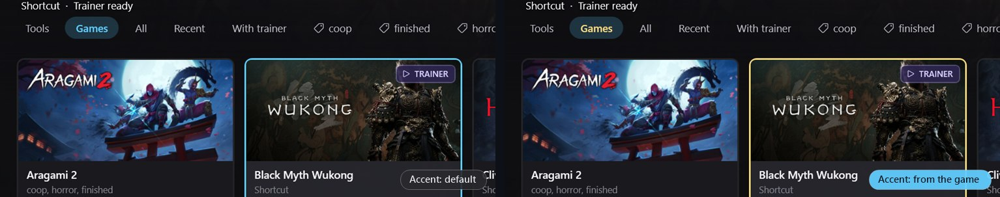
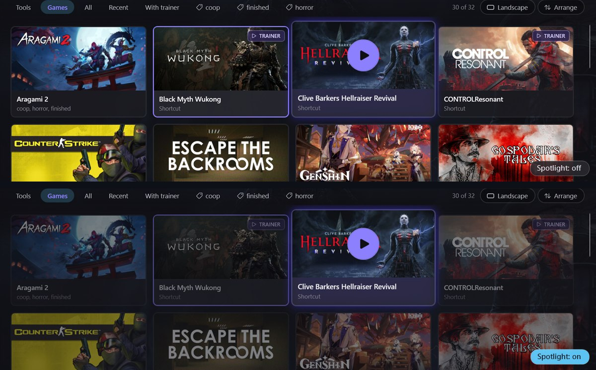
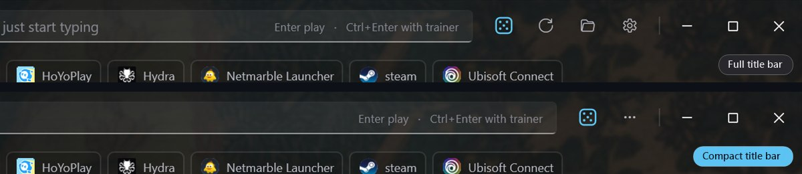
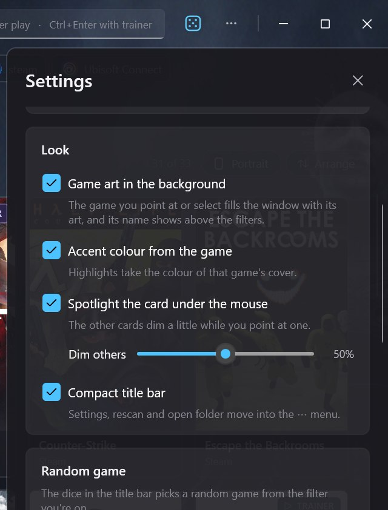
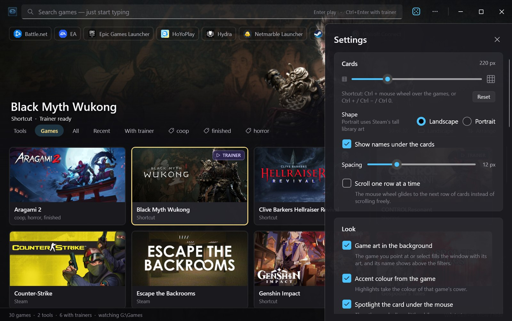

# Simple Game Launcher

[](https://github.com/iosifv/simple-game-launcher/releases/latest)


**Your game shortcuts, as a launcher that looks like it belongs on a gaming PC.** Point it at a folder of game shortcuts and it becomes a fast, searchable wall of cover art that takes on the look of whatever game you point at. No account, no store, no library import: one small exe.


## Why it rocks

- 🎨 **Every game sets the mood:** its artwork as a banner across the top, its colour on every highlight.
- ⚡ **Type, Enter, play.** Search by name, initials (`bmw` → Black Myth Wukong), tag or folder; a global hotkey brings it up from anywhere.
- 🖼️ **Art finds itself** on Steam, the Microsoft Store and GOG, or use your own pictures.
- 🃏 **Cards that feel alive**, a **dice** for when you can't decide, and **trainers** built in.
- 🪶 **Light and native:** Windows 11 dark look, never touches your shortcut files.

## Download

1. Get **GameLauncher.exe** from the [latest release](https://github.com/iosifv/simple-game-launcher/releases/latest).
2. Put it in a folder of its own, for example `Documents\Game Launcher`. It keeps its settings and cover art next to itself, so avoid `Program Files`.
3. Double-click it. On first start it asks for your games folder (see below).

It's a single file with everything included: no installer, nothing else to install. To update, replace `GameLauncher.exe` with the new one; your settings and covers are kept.

## Getting started: your games folder

The launcher shows whatever shortcuts are in one folder. Make a folder (for example `Documents\Games`) and put a shortcut to each game in it:

| Where the game is | How to get a shortcut |
| --- | --- |
| **Steam** | In your Library, right-click the game → **Manage → Add desktop shortcut**, then move the new shortcut from the desktop into your games folder. |
| **Epic Games** | In your Library, click **⋯** on the game → **Manage** → turn on **Desktop shortcut**, then move it into the folder. |
| **Xbox / Microsoft Store, EA, Ubisoft, Battle.net and most others** | Open the **Start menu → All**, find the game and drag it into your games folder. |
| **Any game's `.exe`** | Hold **Alt** while dragging the `.exe` into your games folder. That makes a shortcut instead of moving the file. |

Optional subfolders inside your games folder:

```
Games\
├─ Some Game.lnk        ← every shortcut here is a game
├─ Launchers\           ← Steam, Epic, EA app, … shown as buttons along the top
├─ z\                   ← trainers, matched to games by name
└─ Tools\               ← any other subfolder gets its own filter tab
```

Add, remove or rename a shortcut and the launcher updates within a second. It only reads your shortcuts: it never changes them (the one exception is **Delete…**, which asks first and moves the file to the Recycle Bin).

## What's new in 1.0.7

Each game now shows where it comes from (Steam, Epic, Xbox, GOG, EA, Ubisoft, Battle.net, HoYoPlay, …) under its name and on the banner, worked out from its shortcut. 1.0.6 brought the big artwork banners and your own background art (**Cover → Choose background art…**). See the [releases page](https://github.com/iosifv/simple-game-launcher/releases) for every version.

## A tour

### Every game sets the mood

Point at a game, or select it with the keyboard, and its wide artwork becomes a banner across the top with its name. A dark wash of it fills the rest of the window, and the highlight colour glides to match its cover.


Cards can be landscape or portrait (Steam's tall library art), with or without names:



### Cards that feel alive

The card lifts with a little spring, a light sweeps across it, it glows in its own colours and a **▶ play button** pops in (Ctrl+click plays with the trainer). **Spotlight** dims the rest of the grid. Cards without a cover get a soft glow in the colours of the game's icon.

### See the difference

Every part of the look has its own switch in **Settings → Look**. Here is each one off and on, with everything else the same.

**Game art in the background**



**Accent colour from the game:** the selection ring and the active filter take the cover's colour.



**Spotlight:** the rest of the grid steps back; you choose how much (10–90%).



**Compact title bar:** rescan, open folder and settings fold into one ⋯ menu.




### Make it yours

- **Arrange mode:** drag games, filter tabs and launchers into your own order. Alt+arrows nudge, Reset puts everything back A–Z.
- **Tags** with a one-click editor; each tag becomes a filter.
- **Hide** games you don't want to see (they move to a **Hidden** filter) or **Delete…** a shortcut to the Recycle Bin.
- **Card size, shape, spacing**, names under the cards, **wallpapers** per filter.
- The window reopens **where you left it**, even across several monitors.


| Look | Cards and scrolling | General |
| --- | --- | --- |
|  |  |  |

### Find and start games fast

- **Just start typing** to search; Enter plays.
- **The dice** picks a random game from the filter you're on, and can start it for you.
- **Filters:** Games, All, Recent, With trainer, one per subfolder, one per tag, and Hidden.
- **Global hotkey** (default `Win+Shift+G`) and a tray icon; start with Windows if you like.

### Trainers

Put trainers in the `z` subfolder: `.exe` files with "trainer" in the name, or any shortcut. They're matched to games by name and get a TRAINER badge. **Ctrl+Enter** (or Ctrl+click on ▶) starts the game, then the trainer after a delay you choose. Don't use trainers? Switch them off in Settings and every trace of them disappears.

## Where the artwork comes from

| Source | Used for |
| --- | --- |
| Your own image | Always wins. Right-click a game → **Cover**: a landscape image, a portrait image and background art, each separately. Or search with **Find cover online…**. |
| Steam | Steam games: the app id from a `steam://` link, otherwise an exact name match. Covers, tall library art and the wide background art. |
| Microsoft Store, GOG | Games Steam doesn't have, by exact name, including large background art. |

Epic doesn't let outside apps search its store, but many Epic games are also on the Microsoft Store and are found there. Everything downloaded is cached in `covers\` next to the exe.

## Keyboard

| Keys | Action |
| --- | --- |
| type anything | search (name, initials like `bmw`, tags, folder) |
| Arrows · Enter | select · play |
| Ctrl+Enter | play with trainer (when trainers are on) |
| Esc | clear search / hide |
| Ctrl+Tab | next filter |
| Ctrl + / − / 0, Ctrl+wheel | card size |
| Ctrl+, | settings |
| F5 | rescan |

## FAQ

**Windows says the app might be unsafe.**
The exe isn't code-signed, so SmartScreen warns about it. Click **More info → Run anyway**. It's built from this repository by GitHub Actions; you can check the [workflow](.github/workflows/release.yml).

**A game has no cover, or the wrong one.**
Right-click it → **Cover → Find cover online…** to search Steam, the Microsoft Store and GOG and pick a landscape and a portrait picture. You can also choose any image file, and set background art the same way.

**Something that isn't a game shows up under Games.**
Move its shortcut into a subfolder such as `Tools` (it gets its own filter and stays out of Games), or right-click it → **Hide**.

**The hotkey doesn't work.**
Another app probably uses it. Pick a different one in **Settings → General → Hotkey**; it tells you if a combination is taken.

**Does it need the internet?**
Only to download artwork, once per game. Turn off **Download cover art automatically** in Settings to keep it fully offline.

**It's too flashy for me.**
Switch any part of the look off in **Settings → Look**, and hover tips in **Settings → General**.

**Where are my settings, and how do I back them up or move them?**
Everything lives next to the exe: `launcher-data.json` (settings, tags, trainers, play history, order, hidden games), `covers\` and `wallpapers\`. Copy the whole folder.

**How do I uninstall it?**
Untick **Start with Windows** in Settings, exit from the tray icon, and delete the folder. Nothing else is installed.

## For developers

Requirements: Windows 11 (Windows 10 works without the Mica background), the .NET 10 SDK. The release exe is self-contained; a build with `--self-contained false` needs the [.NET 10 Desktop Runtime](https://dotnet.microsoft.com/download/dotnet/10.0).

```powershell
dotnet run                                   # debug run
dotnet publish -c Release -r win-x64 --self-contained false `
  -p:PublishSingleFile=true -p:IncludeNativeLibrariesForSelfExtract=true -p:DebugType=none -o app
```

To release, push a version tag; GitHub Actions builds the exe and publishes the release:

```powershell
git tag v1.0.7
git push origin v1.0.7
```
